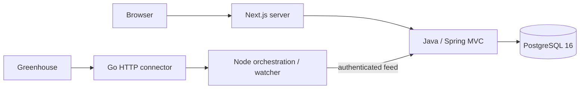

# Inreach architecture

Java is a modular monolith under `dev.inreach`: jobs read service/JPA repository,
ingestion transactional service/JDBC upsert, lifecycle eligibility policy and common
health/error handling. Companies and sources are persisted by ingestion. Separate
service modules can be extracted only when needed. Redis 7.4 is retained for future
coordination; the current application does not require it.

Next.js reads only Java. Its `/api/jobs` route is a compatibility facade, not a
second persistence implementation. Server-rendered pages provide list/search,
pagination and detail routes. HTML job descriptions are not rendered from feeds;
the detail links to the employer. UI uses Tailwind and an attributed shadcn-style
Button with accessible native links and forms.

## Identity and ingestion

Identity is `(provider, board_token, external_job_id)`. Provider IDs, not tracking
URLs or titles, decide duplicates. URLs drop tracking parameters while retaining
functional parameters. PostgreSQL upserts are atomic; two same-ID feed entries must
agree after normalization. Existing raw_payload is retained on conflict.

Go accepts only Greenhouse tokens, calls a fixed HTTPS host, blocks redirects and
non-public DNS addresses, limits response bytes and time. A complete response requires
Greenhouse meta.total to match parsed rows and no truncation. Network failures do not
reach ingestion. A source lock in the runner prevents local overlapping crawls;
a PostgreSQL transaction advisory lock prevents simultaneous writes across hosts.
The Node watcher waits six hours after completion (minimum configurable 15 minutes).
There are no immediate retries after 403/429; the next scheduled run is the bounded
retry. Additional ATS connectors must implement the same normalized feed contract.

## Lifecycle

Persisted states remain lowercase `active`, `suspected_closed`, `closed` for schema
compatibility. Observed jobs reopen to active with a status history row. Missing jobs
**never close automatically** in this foundation. The tested eligibility policy
requires two successful complete observations, nonempty inventory and <=30% decline;
it is deliberately not wired to destructive updates. Full per-job missed-observation
tracking and production source management remain future work.

## API

- GET `/api/jobs?q=&page=1&pageSize=20`: page 1–10000, size 1–100, search <=120.
  Literal substring title search; last_seen_at DESC, id DESC; out-of-range pages clamp.
- GET `/api/jobs/{id}`: active/suspected job or 404.
- GET `/api/jobs/stats`: active, distinct sources, latest import.
- GET `/api/health`: DB readiness, 503 when unavailable.
- POST `/internal/ingestion/greenhouse`: Bearer token, >=24 characters; validated
  board, complete, rawCount, jobs[{id,title,url}]. Empty/inconsistent feeds reject.
  Failed writes roll back. Audit counts are in crawl_imports.

Errors use ProblemDetail. Internal import-error persistence is a prepared table;
network failures currently appear in runner stderr rather than import_errors.
