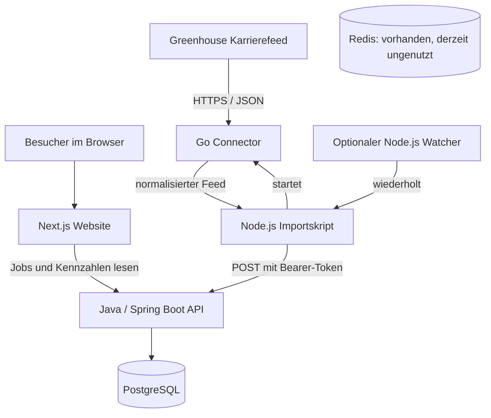

# Inreach – Projektaufbau und aktueller Funktionsumfang

Stand: 2. November 2026. Diese Dokumentation beschreibt den im Repository vorhandenen Code und die Konfiguration. Sie ist keine Live-Prüfung der laufenden Dienste oder des aktuellen Datenbestands. Historische Testergebnisse sind in [VALIDATION.md](VALIDATION.md) festgehalten.

## 1. Was ist Inreach?

Inreach ist das Fundament einer eigenständigen Jobplattform. Die Anwendung sammelt Stellen direkt aus den Karrierefeeds von Unternehmen, speichert sie zentral und stellt sie auf einer deutschsprachigen Website zur Suche bereit. Zur Bewerbung führt ein Link zur ursprünglichen Stelle beim Unternehmen.

Der aktuell implementierte Datenlieferant ist **Greenhouse**, ein Bewerbermanagementsystem, das Unternehmen für ihre Karriereseiten verwenden. Ein Unternehmen wird dabei über seinen Greenhouse-Board-Token angesprochen, beispielsweise `elastic`. Der Connector ist für unterschiedliche gültige Greenhouse-Board-Tokens nutzbar; die Skripte verwenden standardmäßig `elastic`.

Das Projekt besitzt bereits einen vollständigen Weg vom externen Feed bis zur sichtbaren Stellenanzeige. Es ist aber noch keine ausgebaute Recruiting-Plattform mit Konten, Bewerbungsverwaltung, Empfehlungen oder einer Verwaltung für zahlreiche Quellen.

## 2. Was kann man derzeit damit machen?

| Bereich | Aktueller Stand |
| --- | --- |
| Stellen ansehen | Jobliste mit Titel, Quellenkennung und Link zur Detailseite |
| Stellen suchen | Suche nach einem Teil des Jobtitels, ohne Beachtung der Groß-/Kleinschreibung |
| Ergebnisse durchblättern | Seitennavigation, standardmäßig 20 Stellen pro Seite |
| Details öffnen | Eigene Detailseite mit Titel, Board-Kennung und Bewerbungslink |
| Beim Unternehmen bewerben | Weiterleitung über einen externen Link; keine Bewerbung innerhalb von Inreach |
| Kennzahlen ansehen | Anzahl nicht geschlossener Stellen, gespeicherter Quellen und Zeitpunkt des letzten Imports |
| Greenhouse importieren | Manueller Abruf eines Boards und anschließender authentifizierter Import |
| Wiederkehrend abrufen | Lokaler Watcher, standardmäßig sechs Stunden nach Ende des vorherigen Laufs |
| Vorhandene Stellen aktualisieren | Titel, bereinigte URL, letzter Sichtungszeitpunkt und aktiver Status werden aktualisiert |
| Duplikate vermeiden | Identifikation über Anbieter, Board und externe Job-ID |
| Datenfehler abfangen | Validierung, Transaktionen, Quellen-Sperren und verständliche Fehlerzustände |

Die Oberfläche enthält Lade-, Leer-, Fehler- und Nicht-gefunden-Zustände. Eine Suche ohne Treffer zeigt eine entsprechende Meldung und einen Link zurück zu allen Stellen. Ist das Backend nicht erreichbar, meldet die Website die vorübergehende Nichtverfügbarkeit.

**Wichtige Einschränkung:** „Aktive Stellen“ meint in der derzeitigen Implementierung alle Stellen, deren Status nicht `closed` ist. Dazu gehören auch Einträge mit `suspected_closed`. Weil fehlende Stellen noch nicht automatisch geschlossen werden, beweist diese Zahl nicht, dass alle Einträge aktuell beim Arbeitgeber verfügbar sind.

## 3. Der Gesamtaufbau

Das Repository bündelt drei Anwendungsteile und die lokale Infrastruktur:



**Die Website präsentiert die Daten.** Next.js erzeugt die Seiten auf dem Server und fragt die Java-API ab. Im Frontend gibt es keine eigene Datenbankanbindung und kein SQL.

**Die Java-API ist die zentrale fachliche Instanz.** Sie entscheidet, welche Eingaben gültig sind, welche Jobs angezeigt werden und wie Imports die gespeicherten Daten verändern. Sie besitzt die Datenbankzugriffe und die Regeln für den Stellenstatus.

**Der Go-Connector liest die externe Quelle.** Er ruft Greenhouse ab, prüft und normalisiert die Antwort und gibt einen JSON-Feed aus. Er schreibt selbst nichts in die Datenbank.

**Die Node.js-Skripte verbinden Abruf und Import.** Sie starten den Connector, übergeben dessen Ergebnis an Java und können den Vorgang wiederholen. Sie enthalten keine zweite Persistenzschicht.

Damit gibt es mehrere Prozesse, aber keine verteilte Sammlung eigenständiger fachlicher Backends. Das Java-Backend ist ein modular gegliederter Monolith: eine Anwendung mit getrennten Paketen für Lesen, Import, Lebenszyklus und gemeinsame Infrastruktur.

## 4. Verzeichnisse und wichtige Dateien

```text
job-platform/
├── apps/web/                         Website
│   ├── src/app/                      Seiten und Next.js-Routen
│   │   ├── page.tsx                  Startseite, Suche, Liste und Kennzahlen
│   │   ├── jobs/[id]/page.tsx        Jobdetail und Bewerbungslink
│   │   ├── api/jobs/route.ts         Weitergabe der Jobsuche an Java
│   │   └── api/health/route.ts       Erreichbarkeitsprüfung des Webdienstes
│   ├── src/components/               Jobkarte und UI-Bausteine
│   ├── src/lib/jobs.ts               API-Client, Datentypen und Eingabehilfen
│   └── tests/                        Kleine Node.js-Tests
├── services/api/                     Zentrales Java-Backend
│   ├── src/main/java/dev/inreach/
│   │   ├── jobs/                     Controller, Suchlogik und JPA-Zugriff
│   │   ├── ingestion/                Geschützter Import und Datenabgleich
│   │   ├── lifecycle/                Vorbereitete Schließungsbedingungen
│   │   └── common/                   Healthcheck und Fehlerantworten
│   ├── src/main/resources/
│   │   ├── application.properties    Datenbank-, Server- und Flyway-Konfiguration
│   │   └── db/migration/             Versionierte SQL-Migrationen
│   ├── src/test/                     Java- und Datenbankintegrationstests
│   └── Dockerfile                    Containerbau des Backends
├── services/crawler/                 Go-Connector
│   ├── cmd/crawl/main.go             Kommandozeilenprogramm und Feed-Ausgabe
│   ├── greenhouse/                   HTTP-Abruf, Parser und Tests
│   └── LICENSE-UPSTREAM              MIT-Lizenz des übernommenen Quellcodeanteils
├── scripts/
│   ├── crawl-greenhouse.mjs          Einmaliger Abruf samt Import
│   ├── watch-greenhouse.mjs          Wiederholte Ausführung für ein Board
│   └── start-api.mjs                 Start einer zuvor gebauten Java-JAR
├── docs/                             Architektur, Entwicklung und Nachweise
├── licenses/                         Ergänzende Lizenztexte
├── .github/workflows/ci.yml          Automatisierte Prüfungen
├── compose.yaml                      API, PostgreSQL und Redis
├── .env.example                      Vorlage für lokale Konfiguration
└── THIRD_PARTY_NOTICES.md            Herkunft und Drittanbieterhinweise
```

Lokale Zugangsdaten, Datenbankdumps, Archive, Build-Ausgaben und die lokale Upstream-Referenz gehören nicht zu den versionierten Projektinhalten.

## 5. Eingesetzte Technologien

Die Angaben beziehen sich auf die Definitionen im Repository, nicht auf eine Prüfung der jeweils neuesten verfügbaren Versionen. Bei npm sind teilweise Versionsbereiche statt exakter Versionen definiert; die konkrete Auflösung steht in `package-lock.json`.

| Teil | Technologien | Aufgabe |
| --- | --- | --- |
| Web | Next.js 16, React 19, TypeScript | Serverseitig erzeugte Seiten und Navigation |
| Gestaltung | Tailwind CSS 4, shadcn/ui-Button-Muster, Radix Slot | Layout und wiederverwendbare UI-Bausteine |
| Backend | Java 25, Spring Boot 4.1.2, Spring MVC | HTTP-API und Geschäftslogik |
| Datenzugriff | JPA/Hibernate, Spring JDBC | Abfragen sowie gezielte SQL-Imports |
| Datenbank | PostgreSQL 16 | Stellen, Quellen, Importprotokolle und Statushistorie |
| Schema | Flyway | Kontrollierte Weiterentwicklung der Datenbank |
| Connector | Go, Modulvorgabe 1.24.0 | Abruf und Aufbereitung von Greenhouse-Daten |
| Orchestrierung | Node.js, für Entwicklung/CI Node 24 | Connector starten und Feed an Java senden |
| Infrastruktur | Docker Compose, Redis 7.4 | Lokale Dienste; Redis derzeit ohne Anwendungsfunktion |
| Prüfungen | JUnit, Testcontainers, Node-Test-Runner, Go-Tests, GitHub Actions | Automatisierte Qualitätskontrolle |

## 6. Wie eine Stelle in die Plattform gelangt

Ein typischer Import wird aus dem Projektverzeichnis gestartet:

```powershell
node --env-file=.env scripts/crawl-greenhouse.mjs elastic
```

Der Ablauf besteht aus folgenden Schritten:

1. **Board und Konfiguration prüfen:** Das Skript akzeptiert einen Board-Token statt einer frei wählbaren Crawl-URL und verlangt den lokalen Import-Token.
2. **Lokale Quelle sperren:** Ein Verzeichnis unter `.local/locks/<board>/` verhindert überlappende Läufe desselben Boards durch dieses Skript.
3. **Go starten:** Das Skript führt `go run ./cmd/crawl -board <board>` im Connector-Verzeichnis aus.
4. **Greenhouse abrufen:** Der Connector fragt den festen HTTPS-Host `boards-api.greenhouse.io` ab. Es wird kein Browser gestartet.
5. **Antwort prüfen:** Der Parser kontrolliert unter anderem JSON-Struktur, externe Job-IDs und die Anzahl der Einträge. `meta.total` muss für eine bestätigte Vollständigkeit zur gelesenen Anzahl passen. Mehr als 50.000 Jobs kennzeichnen den Bestand als abgeschnitten.
6. **Feed erzeugen:** Die CLI gibt Board, Vollständigkeit, Rohanzahl und pro Job die Felder `id`, `title`, `url` aus.
7. **Authentifiziert importieren:** Das Node.js-Skript sendet diesen Feed mit Bearer-Token an `/internal/ingestion/greenhouse`.
8. **Transaktional speichern:** Java validiert die Daten, sperrt die Quelle zusätzlich in PostgreSQL, legt Unternehmen und Quelle bei Bedarf an und fügt Jobs ein oder aktualisiert sie.
9. **Import protokollieren:** Anzahl eindeutiger Jobs, Duplikate und Vollständigkeitskennzeichen werden gespeichert. Anschließend wird die lokale Sperre freigegeben.

Schlägt der externe Abruf oder das Parsen fehl, erreicht kein Feed den Import-Endpunkt. Schlägt die Datenbankverarbeitung fehl, wird die gesamte Importtransaktion zurückgerollt.

### Was genau wird importiert?

Der Go-Parser kann bereits umfangreichere Felder wie Beschreibung, Standorte und Metadaten auslesen. **Die aktuelle CLI übergibt davon jedoch nur ID, Titel und URL an Java.** Deshalb sind Beschreibungen und Standortfilter noch keine durchgängigen Produktfunktionen.

Ein nicht leerer, ansonsten gültiger Feed mit `complete=false` kann importiert werden. Java protokolliert dann den unvollständigen Zustand; es schließt dadurch keine fehlenden Stellen. Leere Feeds oder eine Abweichung zwischen `rawCount` und tatsächlicher Listengröße werden abgelehnt.

### Regelmäßiger Abruf

```powershell
node --env-file=.env scripts/watch-greenhouse.mjs elastic
```

Der Watcher führt sofort einen Lauf aus und wartet nach dessen Ende standardmäßig 360 Minuten bis zum nächsten Lauf. `CRAWL_INTERVAL_MINUTES` erlaubt 15 bis 1.440 Minuten. Ein Watcher-Prozess bearbeitet ein Board. Eine zentrale Verwaltung vieler Quellen oder ein produktiver Scheduler ist noch nicht vorhanden.

Bei Fehlern gibt es keine sofortige Wiederholungsschleife; der nächste geplante Lauf übernimmt den nächsten Versuch. Meldungen erscheinen in der Prozessausgabe.

## 7. Datenmodell und Identität

### Die wichtigsten Tabellen

| Tabelle | Zweck und wesentliche Inhalte |
| --- | --- |
| `crawled_jobs` | Stellen mit interner ID, Anbieter, Board, externer Job-ID, Titel, URL, Rohdaten, Status sowie erster und letzter Sichtung |
| `crawl_imports` | Importzeitpunkt, Quelle, Rohanzahl, gültige Anzahl, Duplikate, Vollständigkeit und weitere Importmerkmale |
| `companies` | Unternehmen; aktuell wird der Board-Token als Name verwendet |
| `career_sources` | Zuordnung von Anbieter und Board zu einem Unternehmen |
| `job_status_history` | Statuswechsel mit altem/neuem Status, Zeitpunkt und Begründung |
| `import_errors` | Vorbereitete Tabelle für Importfehler; vom aktuellen Ablauf noch nicht befüllt |

Die Identität einer Stelle ist die Kombination:

```text
provider + board_token + external_job_id
```

Beispiel: `greenhouse + elastic + 123456`. Die Zahl ist hier nur ein Beispiel für eine Provider-ID.

Ein geänderter Titel oder eine Tracking-URL erzeugt deshalb keine neue Stelle. Ein eindeutiger Datenbankschlüssel sichert diese Regel zusätzlich ab. Bei einem erneuten Import bleiben die interne ID, der erste Sichtungszeitpunkt und vorhandene Rohdaten erhalten.

Neue Stellen erhalten über den aktuellen Import lediglich ein minimales `raw_payload` mit der externen ID. Das Feld ist somit derzeit kein vollständiges Archiv jeder Greenhouse-Antwort.

### Doppelte Einträge und URL-Bereinigung

Identische Einträge mit derselben externen ID werden innerhalb eines Feeds zusammengefasst und als Duplikate gezählt. Widersprechen sich Einträge derselben ID nach der Normalisierung, wird der Import abgelehnt.

Java akzeptiert für neue Import-URLs HTTPS ohne eingebettete Zugangsdaten und ohne abweichenden Port. Die Bereinigung entfernt unter anderem `utm_*`, `gh_src`, `source` und `ref`, entfernt Fragmente und sortiert verbleibende Query-Parameter. Funktionale Parameter können dadurch erhalten bleiben, während typische Tracking-Zusätze verschwinden.

### Schemaweiterentwicklung

`V1__existing_jobs.sql` bildet die bisherigen Stellen- und Importtabellen ab. `V2__ingestion_foundation.sql` ergänzt Unternehmen, Quellen, Historie und weitere Importinformationen und übernimmt vorhandene Quellen aus den Jobs.

Flyway führt Migrationen beim API-Start aus. Für eine vorhandene Datenbank ohne Flyway-Historie ist eine Baseline bei Version 0 konfiguriert. Hibernate prüft das Schema mit `validate`, statt Tabellen automatisch neu zu erzeugen. Flyway Clean ist deaktiviert.

Angewandte Migrationen werden nicht nachträglich verändert. Weitere Schemaänderungen müssen als zusätzliche Migrationen erfolgen.

## 8. Lebenszyklus einer Stelle

Das Datenmodell kennt drei Statuswerte:

| Status | Bedeutung im aktuellen System |
| --- | --- |
| `active` | Als aktiv gespeichert; beobachtete Stellen werden auf diesen Status gesetzt |
| `suspected_closed` | Für einen Verdachtszustand vorgesehen; bleibt in der öffentlichen Liste sichtbar |
| `closed` | Wird aus Liste und Detailzugriff ausgeschlossen |

Wird eine zuvor nicht aktive Stelle erneut importiert, setzt Java sie auf `active` und protokolliert den Wechsel in `job_status_history`.

**Fehlende Stellen werden derzeit niemals automatisch geschlossen.** Auch ein vollständiger neuer Feed verändert den Status nicht enthaltener Jobs nicht. Dadurch können ältere, beim Arbeitgeber entfernte Anzeigen weiter sichtbar bleiben.

Die Klasse `LifecyclePolicy` enthält bereits eine separat getestete Schutzbedingung für eine mögliche spätere Schließungslogik: erfolgreicher und vollständiger Lauf, positiver alter und neuer Bestand, höchstens 30 Prozent Bestandsrückgang und mindestens zwei aufeinanderfolgende Fehlbeobachtungen. Diese Prüfung ist noch nicht an automatische Statusänderungen angeschlossen. Die dauerhafte Erfassung fehlender Beobachtungen pro Job fehlt ebenfalls.

## 9. Suche, Darstellung und API

### Wie die Suche funktioniert

Die Suche ist eine Teilstringsuche ausschließlich im Titel. `Security` findet beispielsweise Titel mit diesem Text unabhängig von dessen Groß-/Kleinschreibung. SQL-Sonderzeichen wie `%` und `_` werden als tatsächliche Suchzeichen behandelt, nicht als frei verwendbare Platzhalter.

Sortiert wird zuerst nach `last_seen_at` absteigend, danach nach interner ID absteigend. Die zusätzliche ID-Sortierung macht die Reihenfolge bei gleichen Zeitpunkten eindeutig. Da es eine seitennummernbasierte Abfrage ist, können gleichzeitige Imports die Ergebnisse zwischen zwei Seitenaufrufen dennoch verschieben.

Es gibt noch keine Relevanzsortierung, Volltextsuche über Beschreibungen, geografische Suche oder Filter nach Remote, Gehalt und Beschäftigungsart.

### Java-Endpunkte

| Methode | Pfad | Verhalten |
| --- | --- | --- |
| `GET` | `/api/jobs?q=&page=1&pageSize=20` | Nicht geschlossene Stellen suchen und seitenweise abrufen |
| `GET` | `/api/jobs/{id}` | Einzelne nicht geschlossene Stelle; sonst 404 |
| `GET` | `/api/jobs/stats` | Nicht geschlossene Stellen, gespeicherte Quellen und letzter Import |
| `GET` | `/api/health` | API einschließlich Datenbankverbindung prüfen |
| `POST` | `/internal/ingestion/greenhouse` | Greenhouse-Feed mit Bearer-Authentifizierung importieren |

Der Suchbegriff ist auf 120 Zeichen begrenzt. `page` erlaubt 1 bis 10.000, `pageSize` 1 bis 100. Liegt eine gültige angefragte Seite hinter dem Ergebnisende, wird die letzte Ergebnisseite verwendet. Auch bei null Treffern meldet die API mindestens eine Seite.

Die Suchantwort enthält `jobs`, `total`, `page`, `pages`, `query` und `pageSize`. Ein Job liefert `id`, `title`, `source_url`, `provider`, `board_token`, `external_job_id` und `last_seen_at`. Die interne ID wird als String ausgegeben.

Die Statistik `sources` zählt die gespeicherten Einträge in `career_sources`; sie ist keine Live-Prüfung, ob jede Quelle gerade erreichbar ist. `last_import` ist der neueste gespeicherte Importzeitpunkt und kann auch zu einem als unvollständig markierten Import gehören.

Fehler der Java-API werden über `ProblemDetail` beschrieben. Beispiele sind 400 für ungültige Eingaben, 401 für einen nicht autorisierten Import, 404 für fehlende Stellen, 409 für eine bereits gesperrte Importquelle und 503 bei Datenbankproblemen.

### Die Rolle der Next.js-Routen

Die Website hat zusätzlich `/api/jobs` als Fassade für die Java-Suche. Diese Route besitzt keine eigene Datenhaltung; die Seiten selbst nutzen den gemeinsamen serverseitigen API-Client. API-Abrufe verwenden `no-store` und ein Timeout von zehn Sekunden.

Der Web-Endpunkt `/api/health` bestätigt nur, dass Next.js antwortet. Der gleichnamige Java-Endpunkt prüft dagegen auch die Datenbank. Ein erfolgreicher Web-Healthcheck sagt deshalb nichts über die Funktionsfähigkeit des Imports oder der Datenbank aus.

## 10. Lokaler Betrieb und Konfiguration

Docker Compose startet derzeit **Java-API, PostgreSQL und Redis**. Website, Connector und Watcher sind nicht als Compose-Dienste definiert und werden separat gestartet.

| Dienst | Lokaler Zugriff | Startart |
| --- | --- | --- |
| Website | `http://localhost:3000` | Next.js-Entwicklungsserver oder separater Build/Start |
| Java-API | `http://127.0.0.1:8080` | Compose oder zuvor gebaute native JAR |
| PostgreSQL | `127.0.0.1:5433` | Compose; intern Containerport 5432 |
| Redis | `127.0.0.1:6379` | Compose; aktuell von der Anwendung ungenutzt |

Compose veröffentlicht API, PostgreSQL und Redis nur auf `127.0.0.1`. Beim Web-Entwicklungsserver ist im vorhandenen `npm run dev` dagegen keine explizite Loopback-Adresse vorgegeben. Für einen ausdrücklich lokalen Webstart kann `npm run dev --prefix apps/web -- --hostname 127.0.0.1` verwendet werden.

### Konfigurationsdateien

Die Root-Datei `.env` versorgt Compose und die mit `--env-file=.env` gestarteten Node.js-Skripte. `apps/web/.env.local` konfiguriert das Frontend. Vorlagen sind vorhanden; bestehende lokale Dateien mit Zugangsdaten dürfen nicht überschrieben werden.

| Variable | Verwendung |
| --- | --- |
| `POSTGRES_USER`, `POSTGRES_PASSWORD`, `POSTGRES_DB` | Datenbankzugang und Datenbankname |
| `INREACH_DATABASE_URL` | JDBC-Verbindung für Java; Compose setzt die interne Containeradresse |
| `INREACH_API_BASE_URL` | Zieladresse der Java-API für Website und Importskript |
| `INREACH_INGESTION_TOKEN` | Gemeinsames Geheimnis von Importskript und Backend, mindestens 24 Zeichen |
| `INREACH_POSTGRES_VOLUME`, `INREACH_REDIS_VOLUME` | Namen der externen Daten-Volumes |
| `CRAWL_INTERVAL_MINUTES` | Wartezeit des Watchers nach einem Lauf |
| `INREACH_GO` | Optionaler Pfad zum Go-Programm für das Importskript |
| `INREACH_BIND_ADDRESS`, `INREACH_API_PORT` | Optionale native Serveradresse und Port der Java-API |

### Start bei bereits eingerichteter Umgebung

Voraussetzung sind Docker Desktop, eine passende lokale Konfiguration und die vorhandenen externen Volumes. Für Website und Import werden Node.js 24 und Go ab 1.24 benötigt. Native Backend-Entwicklung verwendet Java 25; der Compose-Build stellt seine Java-Umgebung selbst bereit.

```powershell
# Im Projektverzeichnis:
docker compose up -d --build
npm ci --prefix apps/web
npm run dev --prefix apps/web -- --hostname 127.0.0.1
```

In einem zweiten Terminal:

```powershell
node --env-file=.env scripts/crawl-greenhouse.mjs elastic
```

Für eine neue Installation oder die Übernahme bestehender Container beschreibt [DEVELOPMENT.md](DEVELOPMENT.md) die notwendigen Schritte. API-Container und native API dürfen nicht gleichzeitig denselben Port belegen. `scripts/start-api.mjs` startet eine bereits gebaute JAR; es baut sie nicht selbst.

### Erhalt bestehender Daten

Die standardmäßig verwendeten externen Volumes heißen weiterhin:

```text
job-platform_postgres_data
job-platform_redis_data
```

Diese Namen sind unabhängig vom aktuellen Compose-Projektnamen `inreach`. Sie erhalten die Zuordnung zum vorhandenen Datenbestand. Für eine Neuinstallation müssen die externen Volumes vorher angelegt werden; für eine bestehende Installation werden sie weiterverwendet. Bestehende Zugangsdaten, Backups und Datenvolumes sind zu erhalten. Datenlöschung und Volume-Bereinigung sind kein Bestandteil des normalen Start- oder Updateablaufs.

## 11. Bereits eingebaute Schutzmaßnahmen

- **Geschützter Schreibzugriff:** Der interne Import verlangt den passenden Bearer-Token. Bei fehlendem oder zu kurzem serverseitigem Token ist kein erfolgreicher Import möglich.
- **Zentrale Validierung:** Java prüft unter anderem Board, IDs, Feldlängen, Feedgröße, Anzahl und URL-Format.
- **Atomare Imports:** Zusammengehörige Datenänderungen laufen in einer Datenbanktransaktion.
- **Quellen-Sperren:** Das Skript sperrt lokal pro Board; PostgreSQL verhindert zusätzlich gleichzeitige Importtransaktionen derselben Quelle.
- **Begrenzter externer Abruf:** Der produktiv verwendete Go-Pfad nutzt einen festen HTTPS-Host, blockiert Redirects und nicht öffentliche DNS-Ziele und begrenzt Antwortgröße und Laufzeit.
- **Keine Umgehung externer Sperren:** HTTP-Fehler und eine TDM-Reservierung führen zum Fehler statt zu einem alternativen Abrufversuch.
- **Keine Schließung durch fehlende Daten:** Fehlerhafte, unvollständige oder leere Antworten führen nicht zur automatischen Schließung bestehender Jobs.
- **Schema kontrollieren:** Flyway verwaltet Änderungen, Hibernate validiert das Ergebnis.

Dies ist noch keine vollständige Betriebsplattform für öffentliche Nutzung. Benutzeranmeldung, öffentliche Zugriffskontrollen, Gateway-Rate-Limits und eine produktive Deployment-Konfiguration sind nicht implementiert.

## 12. Tests und Qualitätssicherung

Die Prüfschritte sind sowohl lokal dokumentiert als auch in `.github/workflows/ci.yml` für Pushes und Pull Requests hinterlegt.

| Bereich | Vorhandene Prüfungen |
| --- | --- |
| Java | HTTP- und PostgreSQL-Integrationstests, Suche, Pagination, Validierung, Imports, Duplikate, Authentifizierung und Lifecycle-Schutzbedingungen |
| Go | Parser, Provider-IDs, Vollständigkeit, Board-Tokens, HTTP-Verhalten und Ablehnung privater DNS-Ziele |
| Web | Eingabegrenzen und sichere ausgehende Links; zusätzlich Lint, Typprüfung und Produktionsbuild |

Die Java-Integrationstests verwenden eine eigene PostgreSQL-Testcontainer-Instanz. Sie benötigen Docker und greifen nicht auf den bestehenden Stellenbestand zu. Die Tests starten Spring direkt über JUnit-Lebenszyklusmethoden; die Begründung für diese Lösung steht in [DECISIONS.md](DECISIONS.md).

```powershell
Push-Location services/api
./mvnw.cmd verify
Pop-Location

Push-Location services/crawler
go test ./...
Pop-Location

Push-Location apps/web
npm ci
npm run lint
npm run typecheck
npm test
npm run build
Pop-Location
```

[VALIDATION.md](VALIDATION.md) dokumentiert einen früheren erfolgreichen Prüflauf am 2. November 2026 einschließlich Browserprüfungen und eines Imports von 407 Elastic-Stellen. Diese Zahl ist ein damaliger Nachweis, keine fest eingebaute Datenmenge und keine in dieser Dokumentation neu ermittelte Live-Zahl. Dort sind außerdem offene Befunde und Grenzen des damaligen Prüflaufs aufgeführt.

## 13. Was noch fehlt und wo sich Erweiterungen anschließen

| Bereich | Noch nicht implementiert | Anschlussstelle im bestehenden Projekt |
| --- | --- | --- |
| Weitere Datenquellen | Andere Bewerbermanagementsysteme und allgemeines Webseiten-Crawling | Neue Connectoren und passende validierte Java-Importverträge |
| Vollständige Jobdetails | Durchgängiger Import und Darstellung von Beschreibung, Standorten und weiteren Feldern | CLI-Feed, Java-Datenmodell, zusätzliche Migrationen und Detailseite |
| Erweiterte Suche | Filter, Volltext, Relevanz, Typesense | Java-Suchdienst und Suchoberfläche |
| Quellenverwaltung | Verwaltungsoberfläche, Aktivierung, Zeitpläne und Zustandsübersicht | `companies`, `career_sources` und neue Verwaltungsfunktionen |
| Automatischer Lebenszyklus | Dauerhafte Fehlbeobachtungen und kontrolliertes Schließen | `lifecycle`, Importablauf und Statushistorie |
| Fehlerbeobachtung | Persistente Erfassung externer Fehler und zentrale Auswertung | Vorbereitete `import_errors`-Tabelle und Runner |
| Nutzerfunktionen | Konten, Merkliste, Suchalarme, Profile und Matching | Neue Backend-Module und Webbereiche |
| Bewerbungsprozesse | Uploads, Bewerbungsstatus und Kommunikation innerhalb der Plattform | Neues Produktmodul; aktuell nur Arbeitgeberlink |
| Öffentlicher Betrieb | Produktive Bereitstellung, Zugriffsschutz und Betriebsüberwachung | Infrastruktur und Anwendungskonfiguration |

Redis steht als Infrastruktur bereit, übernimmt aber aktuell weder Cache noch Warteschlange, Sperren oder Zeitplanung. Seine bloße Anwesenheit im Compose-Setup bedeutet daher keine bereits implementierte Hintergrundverarbeitung.

## 14. Herkunft des Codes und weitere Dokumentation

Der Greenhouse-Connector enthält abgeleiteten MIT-lizenzierten Quellcode aus dem JobSeek-Projekt. Die Übernahme betrifft einen begrenzten HTTP-/Parser-Teil, nicht dessen Stellenbestand oder eine vollständige fremde Plattform. Der shadcn/ui-basierte Button besitzt ebenfalls einen zu erhaltenden MIT-Hinweis.

Die maßgeblichen Herkunfts- und Lizenzinformationen stehen in [THIRD_PARTY_NOTICES.md](../THIRD_PARTY_NOTICES.md), `services/crawler/LICENSE-UPSTREAM` und `licenses/shadcn-ui-MIT.txt`. Offene Fragen vor einer Veröffentlichung sind in den bestehenden Projektunterlagen dokumentiert.

| Dokument | Inhalt |
| --- | --- |
| [README.md](../README.md) | Kurzeinstieg und zentrale Befehle |
| [ARCHITECTURE.md](ARCHITECTURE.md) | Kompakte technische Architektur und API-Verträge |
| [DEVELOPMENT.md](DEVELOPMENT.md) | Installation, lokale Entwicklung und Datenübernahme |
| [DECISIONS.md](DECISIONS.md) | Architekturentscheidungen und technische Begründungen |
| [VALIDATION.md](VALIDATION.md) | Dokumentierte Testnachweise und offene Befunde |
| [AUDIT.md](AUDIT.md) | Bestandsaufnahme des Projekts |
| [AGENTS.md](../AGENTS.md) | Verbindliche Regeln für Änderungen am Repository |
